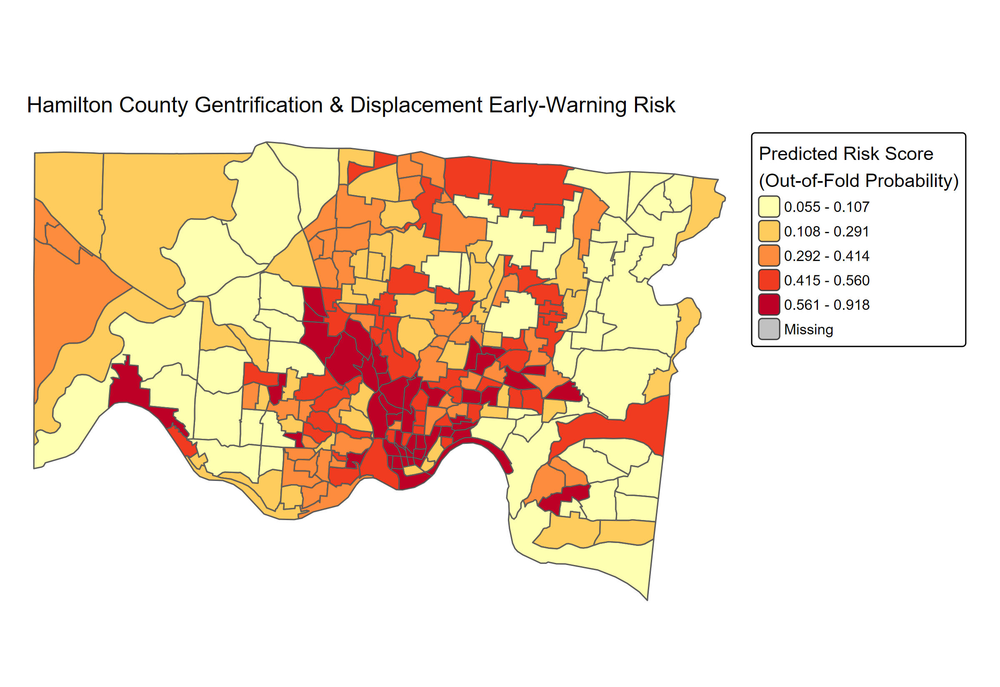
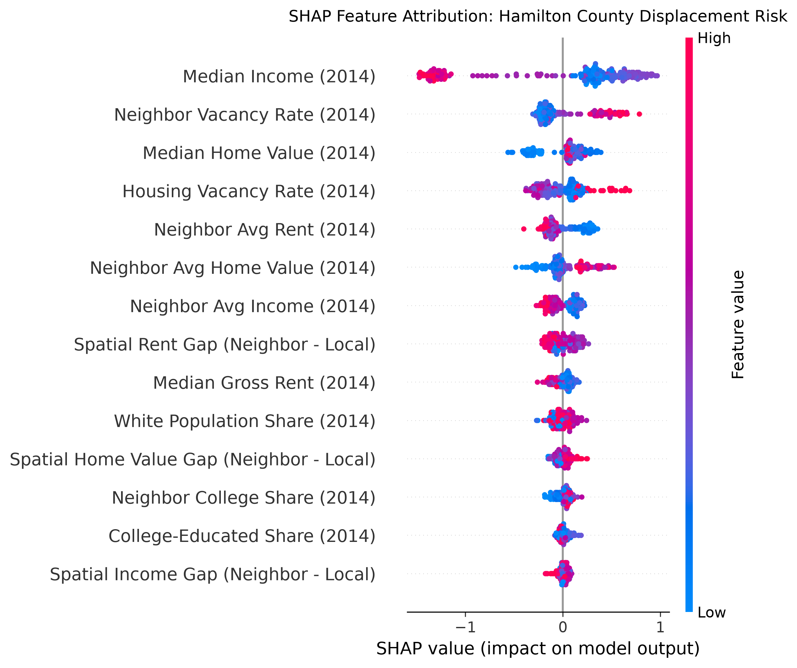

# Demographic Displacement & Gentrification Early-Warning System

## View full report at: https://sokar5555.github.io/hamilton-county-gentrification-early-warning

Neighborhood gentrification risk is estimated across all **226 populated Census tracts** in Hamilton County, Ohio. Tract-level probabilities are generated using a regularized gradient-boosted decision tree model (`LGBMClassifier`) trained strictly on 2010–2014 baseline demographic, socioeconomic, housing-supply, and spatial-spillover indicators from the U.S. Census Bureau.



## Methodology

* **Data & Boundary Harmonization:** American Community Survey (ACS) 5-Year Estimates are pulled for a 2010–2014 baseline and a 2018–2022 evaluation window. Baseline 2010-vintage tracts are apportioned into 2020 tract geometries via the Census Ohio land-area overlap crosswalk, monetary values are CPI-U adjusted to constant 2022 dollars (`1.258`), and educational attainment is measured among the population aged 25+ (`B15003_001`).
* **Feature Set:** 18 strictly leakage-free 2014 baseline predictors are engineered—8 local indicators (median income, median gross rent, median home value, 25+ college-educated share, White population share, vacancy rate, renter-occupied share, and housing density per km²) plus 7 Queen-contiguity neighbor spatial lags and 3 spatial spillover gaps (`rent_gap_14`, `inc_gap_14`, `home_val_gap_14`) built with `spdep`. Net housing-unit change (2014–2022) is excluded from model inputs and used strictly as a post-hoc diagnostic.
* **Target Definition:** Tracts are labeled using a binary gentrification outcome (`49` observed positives; `21.7%` countywide base rate) requiring a lower/moderate-income 2014 baseline (<75th percentile), a top-30% gain in 25+ college-educated share, and above-median rent or home-value growth between 2014 and 2022.
* **Validation & Explainability:** Out-of-fold risk probabilities and SHAP feature attributions are generated via **10×5 repeated stratified K-fold cross-validation** (`RepeatedStratifiedKFold`) so every tract is evaluated exclusively on models that have not seen its label.

## Model Performance

| Metric | Value |
| :--- | :--- |
| **Tracts Scored** | `226` (`0` missing scores) |
| **Observed Gentrified Tracts** | `49` (`0.217` baseline rate) |
| **Out-of-Fold ROC-AUC** | `0.805` |
| **Out-of-Fold PR-AUC** | `0.521` (`2.40x` lift over baseline) |
| **Predicted Risk Range** | `0.031 – 0.912` |
| **Top-10 Hit Rate** | `7 / 10` (`Tracts 10, 9, 17, 27, 26, 269, 264`) |


## Key Insights

* **Core urban risk is driven by baseline income eligibility, surrounding renter exposure, and urban density.** Over-the-Rhine holds the top three predicted risk scores (**Tracts 10, 9, and 17**; `0.875–0.912`), where heavy baseline renter shares (`78.1%` to `94.7%`) intersect with sharp 25+ educational gains (`+15.2` to `+28.8` pp). **Tracts 27, 26, 269, and 264** account for the remaining four confirmed hits in the top 10 (`+18.2` to `+26.7` pp education gains; `66.8%` to `87.5%` baseline renter shares).
* **SHAP attribution highlights spatial context alongside affordability.** Across out-of-fold SHAP values, **Median Income (2014)** acts as the primary eligibility boundary pushing affluent suburban tracts downward, followed by **Neighbor Renter Share (2014)**, **Housing Density per sq km (2014)**, **Neighbor Housing Density (2014)**, **Median Gross Rent (2014)**, and **Spatial Home Value Gap (Neighbor - Local)**.
* **The 3 false positives in the top 10 reflect interpretable supply and demographic dynamics:**
  * *Student-housing expansion:* **Tract 22** (Clifton Heights / CUF; risk `0.845`) recorded the largest unit gain in the top 10 (`+149.1` units / `+10.8%`) alongside a `68.0%` renter share and modest `+4.5` pp education shift, reflecting purpose-built student housing rather than legacy-resident displacement.
  * *Housing-stock contraction without upgrading:* **Tract 18** (risk `0.846`, `59.6%` renter share) experienced stock contraction (`-49.1` units / `-5.3%`) alongside a `-5.0` pp change in college-educated share, showing how dense, lower-income urban tracts can score high despite disinvestment or demolition rather than market heating.
  * *High renter exposure & spillover watch-list:* **Tract 37** (risk `0.823`, `91.0%` renter share, `+$450` spatial rent gap) faces steep surrounding rent pressure on stable stock (`-18.0` units / `-1.4%`) with a `+8.3` pp education gain that falls just short of the binary target threshold.



### Top-10 Highest-Risk Tract Diagnostics

| Rank | Tract | Risk | Renter Share | Unit Change | Edu Shift (25+) | Supply Profile | Target |
| :---: | :--- | :---: | :---: | :---: | :---: | :--- | :---: |
| 1 | **10** (Over-the-Rhine) | `0.912` | `78.1%` | `+34.0` (`+2.8%`) | `+28.8` pp | Stable Stock | `1` |
| 2 | **9** (Over-the-Rhine) | `0.883` | `78.1%` | `-76.0` (`-6.7%`) | `+15.2` pp | Stock Contraction (-5%+) | `1` |
| 3 | **17** (Over-the-Rhine) | `0.875` | `94.7%` | `+96.0` (`+10.2%`) | `+27.6` pp | Stable Stock | `1` |
| 4 | **27** | `0.848` | `66.8%` | `+22.0` (`+2.4%`) | `+22.2` pp | Stable Stock | `1` |
| 5 | **18** | `0.846` | `59.6%` | `-49.1` (`-5.3%`) | `-5.0` pp | Stock Contraction (-5%+) | `0` |
| 6 | **22** (Clifton Heights / CUF) | `0.845` | `68.0%` | `+149.1` (`+10.8%`) | `+4.5` pp | Stable Stock | `0` |
| 7 | **37** | `0.823` | `91.0%` | `-18.0` (`-1.4%`) | `+8.3` pp | Stable Stock | `0` |
| 8 | **26** | `0.822` | `87.5%` | `-165.0` (`-10.1%`) | `+18.4` pp | Stock Contraction (-5%+) | `1` |
| 9 | **269** | `0.804` | `77.9%` | `+49.0` (`+3.0%`) | `+18.2` pp | Stable Stock | `1` |
| 10 | **264** | `0.803` | `85.7%` | `+71.0` (`+5.6%`) | `+26.7` pp | Stable Stock | `1` |

*Full tract GEOIDs, spatial rent gaps, choropleth map, and code are available in the knitted HTML report.*

## Limitations

* **Small sample sensitivity:** With 226 populated tracts and 49 positive cases in a single county, probability rankings and SHAP importances carry higher variance than multi-county datasets even with shallow regularized trees (`max_depth = 3`, `num_leaves = 7`) and repeated CV.
* **University confounding:** Dense, renter-heavy corridors near campuses (such as Tract 22) can score high even when turnover is driven by transient student populations.
* **Ambiguous unit loss:** Housing contraction cannot be separated by cause using Census stock counts alone; unit losses appear during both confirmed gentrification/redevelopment (Tract 9, `-6.7%`; Tract 26, `-10.1%`) and non-gentrifying contraction (Tract 18, `-5.3%`).
* **Data lag, interpolation error, and proxy target:** Multi-year ACS estimates lag current market conditions, carry tract-level margins of error, and rely on land-area areal interpolation for 2010→2020 boundary harmonization. Aggregate socioeconomic shifts are measured rather than direct eviction or involuntary mobility.
* **First-order spatial scope:** Queen-contiguity spatial lags capture immediate neighboring tracts within Hamilton County, omitting broader distance-decay accessibility, cross-county spillovers, and block-level variation within tracts.

## Next Steps

* **Parameterize and scale to multi-county training:** Replace hardcoded state/county FIPS values with R Markdown YAML parameters and pool tracts across comparable Midwest metros, using **spatially blocked cross-validation** (Spatial Group K-Fold) to test out-of-region generalization.
* **Add campus and accessibility controls:** Incorporate distance-to-downtown and distance-to-campus (`sf::st_distance`), student population share, and group-quarters share to separate university churn from residential displacement.
* **Integrate market and disinvestment data:** Add Hamilton County Auditor sales velocity, price-per-square-foot trends, building permits, demolitions, and parcel-level vacancy to distinguish redevelopment from abandonment.
* **Overlay displacement records & run forward validation:** Pair risk scores with eviction filings, tax delinquency, and expiring affordable-housing subsidies, and score 2018–2022 baseline features forward against incoming ACS releases for temporal validation.

## Tech Stack

* **Data & Spatial Workflow (R):** R, R Markdown (`knitr`, `rmarkdown`, `reticulate`), `tidycensus`, `sf`, `spdep`, `tmap`, `tidyverse`, `cli`
* **Modeling & Explainability (Python):** Python, `lightgbm` (`LGBMClassifier`), `scikit-learn`, `shap`, `matplotlib`, `pandas`, `numpy`
* **Data Sources:** U.S. Census Bureau American Community Survey (ACS 5-Year Estimates), TIGER/Line Census Tracts, & 2010–2020 Tract Relationship Crosswalk
* **Reporting:** Standalone knitted HTML report published via GitHub Pages

## Reproducibility

### Prerequisites
* **R (4.2+)** and **Python (3.9+)** configured for `reticulate`.
* A free **U.S. Census Bureau API key** (available at [api.census.gov](https://api.census.gov/data/key_signup.html)).

### Steps
1. **Clone the repository:**
   ```bash
   git clone https://github.com/sokar5555/hamilton-county-gentrification-early-warning.git
   cd hamilton-county-gentrification-early-warning
   ```
2. **Install R and Python dependencies:**
   ```r
   install.packages(c("rmarkdown", "knitr", "reticulate", "tidycensus", "sf", "spdep", "tmap", "tidyverse", "cli"))
   ```
   ```bash
   pip install -r requirements.txt
   ```
3. **Register the Census API key:**
   ```r
   tidycensus::census_api_key("YOUR_CENSUS_API_KEY", install = TRUE)
   ```
4. **Knit the report:**
   ```r
   rmarkdown::render("hamilton-county-gentrification-early-warning_final.Rmd")
   ```
   *ACS data retrieval, 2010→2020 boundary harmonization, spatial feature engineering, 10×5 repeated out-of-fold LightGBM validation, SHAP attribution, and report figures are executed end-to-end when the document is knitted. If multiple Python environments are installed, the target interpreter can be set via `RETICULATE_PYTHON` prior to rendering.*
