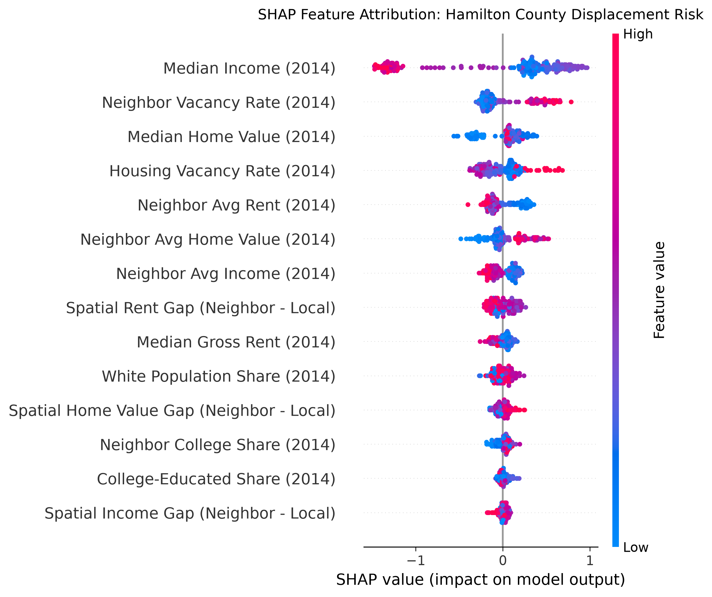

```{r setup, include=FALSE}
knitr::opts_chunk$set(echo = TRUE, warning = FALSE, message = FALSE)
```

# 1. Setup and Configuration

Before any Census data is pulled or spatial models are fit, the R environment and required packages are initialized. Missing CRAN dependencies are installed automatically if needed, the local Census API key is verified from `.Renviron`, and an output folder (`figures/`) is created for saved charts and maps.

```{r setup-packages}
# Required CRAN packages
packages <- c("tidycensus", "tidyverse", "sf", "reticulate", "spdep", "tmap", "knitr", "cli")

# Install any missing R packages
new_packages <- packages[!(packages %in% installed.packages()[, "Package"])]
if (length(new_packages) > 0) {
  install.packages(new_packages, type = "binary")
}

# Load libraries
invisible(lapply(packages, library, character.only = TRUE))

# Verify Census API Key is set in environment (.Renviron)
if (Sys.getenv("CENSUS_API_KEY") == "") {
  stop("CENSUS_API_KEY not found. Run tidycensus::census_api_key('YOUR_KEY', install = TRUE) and restart R.")
}

options(tigris_use_cache = TRUE)
dir.create("figures", showWarnings = FALSE)
```

With the package dependencies loaded, the Census API key confirmed, and the `figures/` directory in place, the workspace is ready for data ingestion.

# 2. Census Data Pipeline & Boundary Harmonization (2010 $\rightarrow$ 2020 Tracts)

Next, American Community Survey (ACS) 5-year estimates are pulled for Hamilton County across two non-overlapping periods: a 2010–2014 baseline and a 2018–2022 evaluation window. Alongside standard demographic and housing-cost indicators, occupancy counts (`B25003_001` and `B25003_003`) are retrieved to compute **renter-occupied share** (the proportion of occupied homes rented rather than owned, indicating how exposed local households are to rent increases), while total housing counts (`B25001_001`) are kept to calculate baseline **vacancy rate** (the share of unoccupied units), baseline housing density, and post-hoc housing unit additions. Because Census tract lines shift between decennial censuses, 2010-vintage figures are apportioned into 2020 tract geometries using Ohio's land-area overlap crosswalk and adjusted to constant 2022 dollars with a `1.258` CPI-U inflation factor, while unpopulated tracts ($\le 50$ residents) are filtered out.

```{r census-pipeline}
# Define ACS 5-year indicators across baseline (2010-2014) and evaluation (2018-2022)
variables_to_pull <- c(
  med_inc           = "B19013_001", # Median Household Income
  med_gross_rent    = "B25064_001", # Median Gross Rent
  med_home_val      = "B25077_001", # Median Home Value
  total_pop         = "B01003_001", # Total Population
  pop_25_plus       = "B15003_001", # Population 25 Years and Over (education denominator)
  pop_bachelors     = "B15003_022", # Bachelor's Degree
  pop_masters       = "B15003_023", # Master's Degree
  pop_prof          = "B15003_024", # Professional School Degree
  pop_phd           = "B15003_025", # Doctorate Degree
  pop_white         = "B02001_002", # White alone
  housing_units     = "B25001_001", # Total housing units
  vacant_units      = "B25002_003", # Vacant housing units
  occ_housing_units = "B25003_001", # Total occupied housing units (tenure denominator)
  renter_units      = "B25003_003"  # Renter-occupied housing units
)

# Pull 2010-2014 baseline (tabular only; 2010 boundaries will be harmonized to 2020)
df_2014_raw <- get_acs(
  geography = "tract",
  variables = variables_to_pull,
  state = "OH",
  county = "Hamilton",
  year = 2014,
  output = "wide",
  geometry = FALSE
)

# Pull 2018-2022 evaluation period with 2020 target tract geometry
df_2022_raw <- get_acs(
  geography = "tract",
  variables = variables_to_pull,
  state = "OH",
  county = "Hamilton",
  year = 2022,
  output = "wide",
  geometry = TRUE
)

# Download Census 2010 to 2020 tract relationship crosswalk for Ohio
cw_url <- "https://www2.census.gov/geo/docs/maps-data/data/rel2020/tract/tab20_tract20_tract10_st39.txt"
tmp_cw <- tempfile(fileext = ".txt")
download.file(cw_url, destfile = tmp_cw, mode = "wb", quiet = TRUE)
cw_ohio <- read_delim(tmp_cw, delim = "|", show_col_types = FALSE)
unlink(tmp_cw)

# Dynamically identify the land intersection area column
intersect_col <- intersect(c("AREALAND_INTRACT", "AREALAND_INT", "AREALAND_PART"), names(cw_ohio))[1]

cw_hamilton <- cw_ohio %>%
  mutate(
    GEOID_TRACT_20 = as.character(GEOID_TRACT_20),
    GEOID_TRACT_10 = as.character(GEOID_TRACT_10)
  ) %>%
  filter(str_starts(GEOID_TRACT_20, "39061")) %>% # Hamilton County FIPS: 39061
  mutate(
    area_int = .data[[intersect_col]],
    weight   = if_else(AREALAND_TRACT_10 > 0, area_int / AREALAND_TRACT_10, 0)
  ) %>%
  select(
    GEOID_10 = GEOID_TRACT_10,
    GEOID_20 = GEOID_TRACT_20,
    weight
  )

# CPI-U deflator for 2014 to 2022 constant dollars
cpi_factor_2014_to_2022 <- 1.258

# Apportion 2014 counts and inflation-adjusted medians into 2020 tract boundaries
df_2014_harmonized <- df_2014_raw %>%
  inner_join(cw_hamilton, by = c("GEOID" = "GEOID_10")) %>%
  mutate(
    adj_pop_25_plus   = pop_25_plusE       * weight,
    adj_pop_bachelors = pop_bachelorsE     * weight,
    adj_pop_masters   = pop_mastersE       * weight,
    adj_pop_prof      = pop_profE          * weight,
    adj_pop_phd       = pop_phdE           * weight,
    adj_pop_white     = pop_whiteE         * weight,
    adj_total_pop     = total_popE         * weight,
    adj_housing_units = housing_unitsE     * weight,
    adj_vacant_units  = vacant_unitsE      * weight,
    adj_occ_units     = occ_housing_unitsE * weight,
    adj_renter_units  = renter_unitsE      * weight
  ) %>%
  group_by(GEOID_20) %>%
  summarize(
    total_pop_14              = sum(adj_total_pop, na.rm = TRUE),
    housing_units_14          = sum(adj_housing_units, na.rm = TRUE),
    college_educated_share_14 = if_else(
      sum(adj_pop_25_plus, na.rm = TRUE) > 0,
      sum(adj_pop_bachelors + adj_pop_masters + adj_pop_prof + adj_pop_phd, na.rm = TRUE) / sum(adj_pop_25_plus, na.rm = TRUE),
      NA_real_
    ),
    pct_white_14              = sum(adj_pop_white, na.rm = TRUE) / total_pop_14,
    vacancy_rate_14           = sum(adj_vacant_units, na.rm = TRUE) / housing_units_14,
    renter_share_14           = if_else(
      sum(adj_occ_units, na.rm = TRUE) > 0,
      sum(adj_renter_units, na.rm = TRUE) / sum(adj_occ_units, na.rm = TRUE),
      NA_real_
    ),
    adj_med_rent_14           = weighted.mean(med_gross_rentE * cpi_factor_2014_to_2022, w = adj_total_pop, na.rm = TRUE),
    adj_med_inc_14            = weighted.mean(med_incE * cpi_factor_2014_to_2022, w = adj_total_pop, na.rm = TRUE),
    adj_med_home_val_14       = weighted.mean(med_home_valE * cpi_factor_2014_to_2022, w = adj_total_pop, na.rm = TRUE),
    .groups = "drop"
  )

# Prepare 2022 evaluation indicators
df_clean_eval <- df_2022_raw %>%
  mutate(
    total_pop_22              = total_popE,
    housing_units_22          = housing_unitsE,
    college_educated_share_22 = if_else(
      pop_25_plusE > 0,
      (pop_bachelorsE + pop_mastersE + pop_profE + pop_phdE) / pop_25_plusE,
      NA_real_
    ),
    pct_white_22              = pop_whiteE / total_popE,
    vacancy_rate_22           = vacant_unitsE / housing_unitsE,
    renter_share_22           = if_else(occ_housing_unitsE > 0, renter_unitsE / occ_housing_unitsE, NA_real_),
    adj_med_rent_22           = med_gross_rentE,
    adj_med_inc_22            = med_incE,
    adj_med_home_val_22       = med_home_valE
  ) %>%
  select(
    GEOID, NAME, geometry, total_pop_22, housing_units_22,
    college_educated_share_22, pct_white_22, vacancy_rate_22, renter_share_22,
    adj_med_rent_22, adj_med_inc_22, adj_med_home_val_22
  )

# Join harmonized 2014 baseline with 2022 evaluation panel and drop unpopulated industrial/riverfront tracts
panel_df_harmonized <- inner_join(df_clean_eval, df_2014_harmonized, by = c("GEOID" = "GEOID_20")) %>%
  filter(total_pop_14 > 50, total_pop_22 > 50, housing_units_14 > 0, housing_units_22 > 0) %>%
  mutate(across(
    where(is.numeric),
    ~ if_else(is.na(.x) | is.nan(.x) | is.infinite(.x), median(.x[is.finite(.x)], na.rm = TRUE), .x)
  ))

glimpse(panel_df_harmonized)
```

A harmonized spatial panel of `r nrow(panel_df_harmonized)` populated 2020 Hamilton County census tracts is produced, pairing inflation-adjusted 2014 baseline indicators—including renter share and housing stock—with 2022 evaluation metrics and median-imputed missing values.

# 3. Spatial Feature Engineering & Target Definition (`spdep`)

In the next step, spatial context features are engineered strictly from 2014 baseline values so no future information leaks into the model. First, **housing density** (`housing_density_14`, total housing units per $\text{km}^2$) is derived to separate dense multi-family urban corridors from lower-density suburban tracts. A row-standardized **Queen-contiguity** neighbor graph is then built—linking every tract to adjacent tracts that share a border or corner—to calculate **spatial lags** (`lag_*_14`), which are simply the average 2014 values across a tract's immediate neighbors. From those neighbor averages, three spillover measures are derived by subtracting the local tract's value from its surrounding average: the **spatial rent gap** (`rent_gap_14`), **spatial income gap** (`inc_gap_14`), and **spatial home-value gap** (`home_val_gap_14`). Positive gap values indicate that surrounding neighborhoods are pricier or more affluent than the local tract (pointing to outward market pressure), while negative values indicate the tract already sits above its immediate neighbors.

Separately, 2014–2022 outcome deltas are computed strictly outside the predictor set to construct `gentrified_target` among lower- and moderate-income tracts, alongside post-hoc **net housing unit change** (`net_unit_change`, `pct_chg_units`, and `supply_profile`) so rising rents on flat housing stock can later be distinguished from major infill apartment construction. Finally, tract geometries are dropped into `model_df` for Python modeling.

```{r spatial-features}
panel_spatial <- panel_df_harmonized %>%
  st_make_valid()

# Build Queen contiguity neighbor graph and row-standardized spatial weights
nb_queen <- poly2nb(panel_spatial, queen = TRUE)
lw_queen <- nb2listw(nb_queen, style = "W", zero.policy = TRUE)

panel_features <- panel_spatial %>%
  mutate(
    # Baseline urban density (2014 housing units per square kilometer)
    area_sqkm          = as.numeric(st_area(geometry)) / 1e6,
    housing_density_14 = housing_units_14 / pmax(area_sqkm, 0.01),

    # 1. 2014 Spatial Spillover Lags (neighboring tract averages - strictly baseline to prevent leakage)
    lag_inc_14          = lag.listw(lw_queen, adj_med_inc_14, zero.policy = TRUE),
    lag_rent_14         = lag.listw(lw_queen, adj_med_rent_14, zero.policy = TRUE),
    lag_home_val_14     = lag.listw(lw_queen, adj_med_home_val_14, zero.policy = TRUE),
    lag_edu_14          = lag.listw(lw_queen, college_educated_share_14, zero.policy = TRUE),
    lag_vacancy_14      = lag.listw(lw_queen, vacancy_rate_14, zero.policy = TRUE),
    lag_renter_share_14 = lag.listw(lw_queen, renter_share_14, zero.policy = TRUE),
    lag_density_14      = lag.listw(lw_queen, housing_density_14, zero.policy = TRUE),

    # 2. Spatial Rent, Income & Home-Value Gaps (surrounding pressure minus local baseline)
    rent_gap_14     = lag_rent_14 - adj_med_rent_14,
    inc_gap_14      = lag_inc_14 - adj_med_inc_14,
    home_val_gap_14 = lag_home_val_14 - adj_med_home_val_14,

    # 3. 2014 -> 2022 Outcome & Supply Deltas (strictly EXCLUDED from LightGBM predictors)
    delta_edu        = college_educated_share_22 - college_educated_share_14,
    pct_chg_rent     = (adj_med_rent_22 - adj_med_rent_14) / adj_med_rent_14,
    pct_chg_home_val = (adj_med_home_val_22 - adj_med_home_val_14) / adj_med_home_val_14,
    net_unit_change  = housing_units_22 - housing_units_14,
    pct_chg_units    = (housing_units_22 - housing_units_14) / housing_units_14,
    supply_profile   = case_when(
      pct_chg_units >= 0.15  ~ "Supply-Driven Infill (+15%+)",
      pct_chg_units <= -0.05 ~ "Stock Contraction (-5%+)",
      TRUE                   ~ "Stable Stock"
    ),

    # Target: Lower/moderate-income baseline (<75th pct) + top-30% education jump + above-median housing cost growth
    eligible_14 = adj_med_inc_14 < quantile(adj_med_inc_14, 0.75, na.rm = TRUE),
    gentrified_target = as.integer(
      eligible_14 &
      (delta_edu >= quantile(delta_edu, 0.70, na.rm = TRUE)) &
      (pct_chg_rent >= median(pct_chg_rent, na.rm = TRUE) |
       pct_chg_home_val >= median(pct_chg_home_val, na.rm = TRUE))
    )
  )

cat(
  "Populated Hamilton County tracts:", nrow(panel_features),
  "| Gentrified tracts (2014-2022):", sum(panel_features$gentrified_target), "\n"
)

# Drop sf geometry before passing tabular feature matrix to Python via reticulate
model_df <- panel_features %>%
  st_drop_geometry()
```

Neighbor-lagged baseline indicators, spatial spillover gaps, baseline renter share, housing density, and post-hoc net unit-change diagnostics are computed across all `r nrow(panel_features)` populated tracts (`r sum(panel_features$gentrified_target)` labeled as gentrified between 2014 and 2022), yielding a leakage-free tabular modeling dataset (`model_df`) ready for handoff to Python.

# 4. LightGBM Modeling & Out-of-Fold SHAP Attribution (`reticulate`)

First, required Python modules (`lightgbm`, `shap`, `sklearn`, `matplotlib`, `pandas`, `numpy`) are verified inside the active `reticulate` environment. Using the Python import name `sklearn` avoids unnecessary `pip` calls during knitting.

```{r python-env-setup}
# Verify required Python modules are available (import name for scikit-learn is "sklearn")
py_modules <- c("lightgbm", "shap", "sklearn", "matplotlib", "pandas", "numpy")
missing_py <- py_modules[!vapply(py_modules, py_module_available, logical(1))]
if (length(missing_py) > 0) {
  stop(
    "Missing Python modules: ", paste(missing_py, collapse = ", "),
    ". Install them once via terminal with `pip install -r requirements.txt` before knitting."
  )
}
```

The Python environment is verified and ready to execute the gradient-boosted classification workflow.

Next, a regularized `LightGBM` binary classifier is trained and evaluated on the 18 leakage-free 2014 baseline and spatial spillover features—incorporating renter share and housing density while keeping `net_unit_change` strictly excluded—using $10 \times 5$ Repeated Stratified K-Fold cross-validation. Out-of-fold probability predictions and **SHAP values** (which quantify how much each feature pushes an individual tract's predicted risk higher or lower) are aggregated across repeats, ROC-AUC and PR-AUC scores are printed, and a SHAP summary chart is exported to `figures/shap_summary.png`.

```{python lightgbm-shap}
import os
os.environ["OMP_NUM_THREADS"] = "1"

import numpy as np
import pandas as pd
import lightgbm as lgb
import shap
import matplotlib
matplotlib.use("Agg")
import matplotlib.pyplot as plt
from sklearn.model_selection import RepeatedStratifiedKFold
from sklearn.metrics import roc_auc_score, average_precision_score

df = r.model_df.copy()

# Strictly 2014 baseline and spatial spillover predictors (no 2022 outcome or unit-addition features)
feature_cols = [
    "adj_med_inc_14",
    "adj_med_rent_14",
    "adj_med_home_val_14",
    "college_educated_share_14",
    "pct_white_14",
    "vacancy_rate_14",
    "renter_share_14",
    "housing_density_14",
    "lag_inc_14",
    "lag_rent_14",
    "lag_home_val_14",
    "lag_edu_14",
    "lag_vacancy_14",
    "lag_renter_share_14",
    "lag_density_14",
    "rent_gap_14",
    "inc_gap_14",
    "home_val_gap_14",
]

X = df[feature_cols]
y = df["gentrified_target"].astype(int).values

# 10x5 Repeated Stratified K-Fold CV for stable small-sample validation
n_splits = 5
n_repeats = 10
rskf = RepeatedStratifiedKFold(n_splits=n_splits, n_repeats=n_repeats, random_state=42)

oof_preds = np.zeros(len(df))
oof_shap = np.zeros((len(df), len(feature_cols)))

lgb_params = {
    "objective": "binary",
    "metric": "auc",
    "boosting_type": "gbdt",
    "n_estimators": 120,
    "learning_rate": 0.03,
    "num_leaves": 7,
    "max_depth": 3,
    "min_child_samples": 8,
    "subsample": 0.8,
    "subsample_freq": 1,
    "colsample_bytree": 0.8,
    "reg_alpha": 0.5,
    "reg_lambda": 1.0,
    "class_weight": "balanced",
    "n_jobs": 1,
    "random_state": 42,
    "verbose": -1,
}

for train_idx, val_idx in rskf.split(X, y):
    X_tr, y_tr = X.iloc[train_idx], y[train_idx]
    X_va = X.iloc[val_idx]

    clf = lgb.LGBMClassifier(**lgb_params)
    clf = clf.fit(X_tr, y_tr)

    oof_preds[val_idx] += clf.predict_proba(X_va)[:, 1] / n_repeats

    explainer = shap.TreeExplainer(clf)
    sv = explainer.shap_values(X_va)
    if isinstance(sv, list):
        sv = sv[1]
    elif getattr(sv, "ndim", 2) == 3:
        sv = sv[:, :, 1]
    oof_shap[val_idx] += sv / n_repeats

roc_auc = float(roc_auc_score(y, oof_preds))
pr_auc = float(average_precision_score(y, oof_preds))
baseline_rate = float(y.mean())
pr_lift = pr_auc / baseline_rate
print(f"Out-of-Fold ROC-AUC: {roc_auc:.3f} | PR-AUC: {pr_auc:.3f} (Baseline Positive Rate: {baseline_rate:.3f} | Lift: {pr_lift:.2f}x)")

# Export publication-ready out-of-fold SHAP summary plot
pretty_names = {
    "adj_med_inc_14": "Median Income (2014)",
    "adj_med_rent_14": "Median Gross Rent (2014)",
    "adj_med_home_val_14": "Median Home Value (2014)",
    "college_educated_share_14": "College-Educated Share (2014)",
    "pct_white_14": "White Population Share (2014)",
    "vacancy_rate_14": "Housing Vacancy Rate (2014)",
    "renter_share_14": "Renter-Occupied Share (2014)",
    "housing_density_14": "Housing Density per sq km (2014)",
    "lag_inc_14": "Neighbor Avg Income (2014)",
    "lag_rent_14": "Neighbor Avg Rent (2014)",
    "lag_home_val_14": "Neighbor Avg Home Value (2014)",
    "lag_edu_14": "Neighbor College Share (2014)",
    "lag_vacancy_14": "Neighbor Vacancy Rate (2014)",
    "lag_renter_share_14": "Neighbor Renter Share (2014)",
    "lag_density_14": "Neighbor Housing Density (2014)",
    "rent_gap_14": "Spatial Rent Gap (Neighbor - Local)",
    "inc_gap_14": "Spatial Income Gap (Neighbor - Local)",
    "home_val_gap_14": "Spatial Home Value Gap (Neighbor - Local)",
}

X_display = X.rename(columns=pretty_names)

plt.figure(figsize=(9, 6.8))
shap.summary_plot(oof_shap, X_display, show=False)
plt.title("SHAP Feature Attribution: Hamilton County Displacement Risk", fontsize=12, pad=12)
plt.tight_layout()
plt.savefig("figures/shap_summary.png", dpi=300, bbox_inches="tight")
plt.close()
```

```{r display-shap, echo=FALSE, out.width="95%"}

```

Across the $10 \times 5$ repeated cross-validation folds, the model achieves an out-of-fold **ROC-AUC of `r sprintf("%.3f", py$roc_auc)`** and a **PR-AUC of `r sprintf("%.3f", py$pr_auc)`** against a **`r sprintf("%.3f", py$baseline_rate)`** baseline positive rate (a **`r sprintf("%.2f", py$pr_lift)`**$\times$ **lift** over random ranking). As shown in `figures/shap_summary.png`, **Median Income (2014)** remains the primary eligibility boundary pushing affluent suburban tracts sharply downward, followed by urban-form and spillover signals—led by **Neighbor Renter Share (2014)**, local and neighboring **Housing Density (2014)**, **Median Gross Rent (2014)**, and **Spatial Home Value Gap (Neighbor - Local)**—which capture urban-core tenant exposure and redevelopment pressure.

# 5. Spatial Risk Map & Top-Tract Supply Diagnostics (`tmap`)

Finally, out-of-fold predicted risk probabilities from Python are joined back onto the 2020 Hamilton County tract polygons. Missing risk scores are explicitly audited to confirm full scoring coverage across all populated tracts, missing-value legend swatches are suppressed so no unused `"Missing"` category appears, a static quantile choropleth map is exported to `figures/hamilton_county_risk_map.png`, and the top 10 highest-risk tracts are tabulated alongside their baseline renter share, spatial rent gap, and 2014–2022 net housing unit change.

```{r spatial-risk-map}
# Attach out-of-fold predicted probabilities back to spatial sf dataframe
panel_results <- panel_features %>%
  mutate(displacement_risk = as.numeric(py$oof_preds))

# Audit missingness explicitly (every populated tract should receive an out-of-fold score)
missing_scores <- sum(is.na(panel_results$displacement_risk))
cat("Populated tracts with missing predicted risk scores:", missing_scores, "\n")

# Render static choropleth map with missing-value legend item explicitly suppressed
tmap_mode("plot")

if (packageVersion("tmap") >= "4.0") {
  risk_map <- tm_shape(panel_results) +
    tm_polygons(
      fill = "displacement_risk",
      fill.scale = tm_scale_intervals(
        style = "quantile",
        n = 5,
        values = "brewer.yl_or_rd"
      ),
      fill.legend = tm_legend(
        title = "Predicted Risk Score\n(Out-of-Fold Probability)",
        na.show = FALSE
      ),
      col = "gray40",
      lwd = 0.5
    ) +
    tm_title("Hamilton County Gentrification & Displacement Early-Warning Risk") +
    tm_layout(legend.outside = TRUE, frame = FALSE)
} else {
  risk_map <- tm_shape(panel_results) +
    tm_fill(
      col = "displacement_risk",
      palette = "YlOrRd",
      style = "quantile",
      n = 5,
      showNA = FALSE,
      title = "Predicted Risk Score\n(Out-of-Fold Probability)"
    ) +
    tm_borders(col = "gray40", lwd = 0.5) +
    tm_layout(
      main.title = "Hamilton County Gentrification & Displacement Early-Warning Risk",
      main.title.size = 1.05,
      legend.outside = TRUE,
      frame = FALSE
    )
}

print(risk_map)
tmap_save(risk_map, filename = "figures/hamilton_county_risk_map.png", width = 8, height = 5.5, dpi = 300)

# Inspect top 10 highest-risk tracts alongside renter share, spatial rent gap, and net unit additions
top10_tracts <- panel_results %>%
  st_drop_geometry() %>%
  arrange(desc(displacement_risk)) %>%
  select(
    GEOID,
    NAME,
    displacement_risk,
    gentrified_target,
    renter_share_14,
    rent_gap_14,
    net_unit_change,
    pct_chg_units,
    delta_edu,
    supply_profile
  ) %>%
  head(10)

knitr::kable(
  top10_tracts,
  digits = 3,
  caption = "Top 10 Highest-Risk Census Tracts in Hamilton County (with Renter Share & 2014-2022 Supply Diagnostics)"
)
```

The resulting choropleth map (`figures/hamilton_county_risk_map.png`) confirms complete coverage across all modeled tracts (`r missing_scores` missing scores), with out-of-fold probabilities ranging from **`r sprintf("%.3f", min(panel_results$displacement_risk))`** to **`r sprintf("%.3f", max(panel_results$displacement_risk))`**. Highest-quintile risk remains concentrated in Cincinnati's urban core—spanning Over-the-Rhine, Pendleton, the West End, and Walnut Hills—and along the Mill Creek / Northside corridor, while outer suburban tracts across northern, western, and eastern Hamilton County fall predominantly into the lowest risk quintile. Across the top 10 highest-ranked tracts, **`r sum(top10_tracts$gentrified_target)` of 10** experienced realized gentrification between 2014 and 2022, and pairing `renter_share_14` with `net_unit_change` clarifies which high-risk corridors experienced appreciation on stable or shrinking housing stock versus significant infill additions.

# 6. Findings, Limitations, False Positives & Next Steps

## Key Findings & Takeaways

- **Spatial Context & Tenant Exposure Drive Risk:** While a tract's own 2014 median income sets the baseline eligibility boundary, neighborhood-level spillover features—including neighboring vacancy rates, adjacent home values, and spatial price gaps—combine with local renter-occupied share and housing density to separate dense, renter-heavy urban neighborhoods exposed to displacement from lower-density homeowner suburbs.
- **Vacancy Acts as a Redevelopment Catalyst:** Elevated local and neighboring 2014 vacancy rates consistently push predicted risk upward. In older Rust Belt urban cores like Cincinnati, high baseline vacancy adjacent to appreciating neighborhoods signals underutilized stock primed for renovation, flipping, or multifamily conversion.
- **Separating Infill Growth from Displacement Pressure:** Tracking 2014–2022 net housing unit change (`net_unit_change` and `pct_chg_units`) as a post-hoc diagnostic distinguishes neighborhoods where rising rents reflect new multifamily infill on vacant or commercial parcels from neighborhoods where housing costs escalated on flat or contracting stock—a practical distinction for housing policy and tenant-protection targeting.

## Interpreting Potential False Positives

High-scoring tracts labeled `gentrified_target = 0` in the top 10 generally reflect interpretable urban dynamics rather than random noise:

- **Watch-List / Leading-Indicator Tracts:** Tracts adjacent to rapidly changing corridors (such as Northside) share nearly identical baseline affordability, renter-share, and spillover profiles with tracts that gentrified between 2014 and 2022, pointing to early-stage or delayed displacement pressure.
- **Student & Institutional Churn Effects:** Tracts near universities (such as Clifton Heights / CUF) exhibit low baseline incomes, high renter shares, and transient student populations that can mimic displacement risk profiles without representing classic legacy-resident displacement.
- **Threshold Boundary Artifacts:** Because `gentrified_target` relies on hard percentile cutoffs (top-30% educational gain and above-median rent or home-value growth), tracts experiencing substantial market pressure just shy of one cutoff are coded as `0`.

## Limitations of the Analysis

- **Small Sample Size:** Modeling a single county yields roughly 220 populated census tracts. Even with shallow regularized trees (`max_depth = 3`, `num_leaves = 7`) and $10 \times 5$ repeated cross-validation, probability estimates and SHAP rankings carry higher variance than multi-county datasets.
- **Proxy Target vs. Direct Displacement:** ACS 5-year estimates capture neighborhood-level demographic and cost shifts rather than individual household out-migration. Adding `net_unit_change` diagnostics partially mitigates conflation with infill construction, but parcel-level eviction or migration records are still required to measure involuntary displacement directly.
- **Areal Interpolation Error & ACS Margins of Error:** Harmonizing 2010 tracts into 2020 boundaries via land-area weights assumes uniform population and housing distribution within split tracts, and 5-year ACS tract estimates carry non-trivial sampling margins of error.
- **Single-Window Historical Calibration:** Because the model is evaluated on a single 2014–2022 cycle, feature weights may partially reflect period-specific market conditions.

## Next Steps: Generalizing to Any U.S. County

To evolve this prototype into a reusable, county-agnostic early-warning framework, the following extensions are recommended:

1.  **Parameterize Geography & Crosswalks:** Replace hardcoded state (`"OH"`), county (`"Hamilton"`), and FIPS (`"39061"`) values with R Markdown YAML parameters (`params$state`, `params$county`), dynamically resolving the corresponding state FIPS code and Census 2010–2020 crosswalk URL so the report can be re-knit for any U.S. county.
2.  **Scale to Multi-County / Metro-Level Training:** Pool tracts across comparable Midwest or Sun Belt metros (e.g., Columbus, Cleveland, Pittsburgh, Indianapolis) to increase training sample size by $5\times$–$10\times$, using **Spatial Group K-Fold cross-validation** to test out-of-region generalization.
3.  **Add Accessibility & High-Frequency Leading Indicators:** Incorporate distance to downtown and major university campuses (`sf::st_distance`), parcel-level assessments, building permits, and eviction filing rates to cleanly separate student-housing churn from residential displacement.
4.  **Temporal Forward Validation:** Freeze the model trained on the 2014 $\rightarrow$ 2022 window and score 2018–2022 baseline features forward to generate live 2022 $\rightarrow$ 2030 watch-lists, validating predictions against incoming 2020–2024 and newer ACS 5-year releases.
